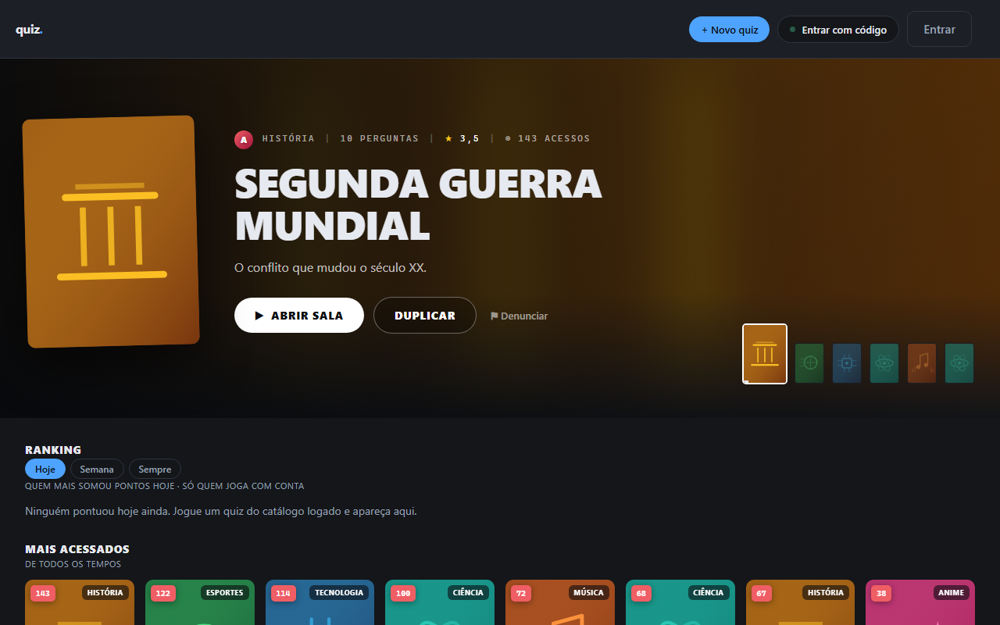
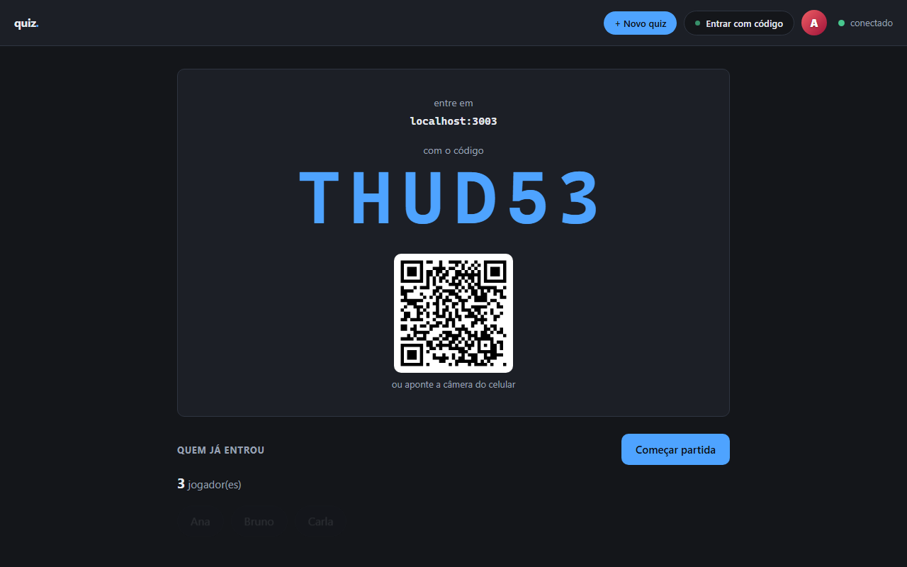
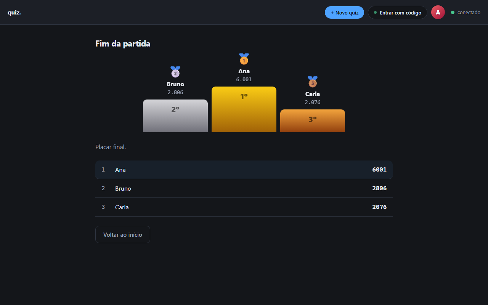
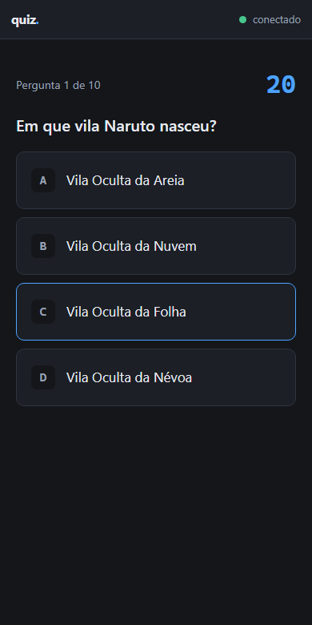
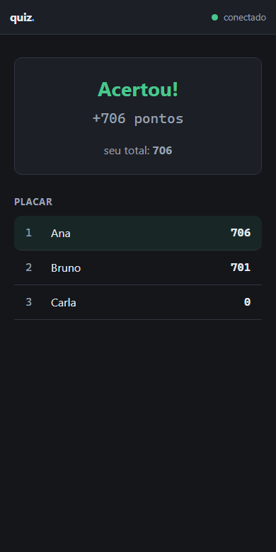

# Quiz

Quiz multiplayer ao vivo. O apresentador abre uma sala, as pessoas
entram pelo celular com um código, e as perguntas aparecem para
todo mundo ao mesmo tempo — com cronômetro e placar atualizando em
tempo real.

`Node 22` · `PostgreSQL 16` · `Redis 7` · `WebSocket` · `Docker Compose` · `Playwright` · `225 testes`




| O telão, esperando a turma | Fim da partida |
|---|---|
|  |  |

| No celular de quem joga | O resultado de cada pergunta |
|---|---|
|  |  |

## O que dá para fazer

- **Jogar ao vivo.** O apresentador abre a sala; a turma entra pelo
  celular com o código ou apontando a câmera para o QR. Cronômetro
  do servidor, placar a cada pergunta, bônus por acertos seguidos e
  pódio no fim.
- **Criar quizzes**, à mão ou com IA (Gemini ou qualquer provedor
  compatível com a API da OpenAI). O tema do quiz é fixo, e gerar
  de novo traz perguntas novas, sem repetir as que já existem.
- **Catálogo público moderado.** Um quiz só entra no catálogo
  depois que a IA lê perguntas e capa; ela também define a
  categoria. Quem joga pode denunciar, e um administrador decide.
- **Montar a partida por tempo**: 30 minutos, 1 hora, 2 horas, ou
  ajustando quantas perguntas e quantos segundos cada uma.
- **Ranking** do dia, da semana e de todos os tempos, só entre quem
  joga com conta — com travas contra inflar pontos.
- **Perfil** com foto, imagem de fundo, bio, cor e o histórico das
  partidas; recuperar senha e apagar a conta.

## O que é

Um projeto de estudo sobre **tempo real**: conexão que fica aberta
e empurra dados para a tela sem o navegador pedir.

O quiz foi escolhido porque, nele, o tempo real não é enfeite. Num
quadro de tarefas dá para atualizar a tela de 5 em 5 segundos e
quase ninguém nota. Numa partida, não: se o cronômetro de um
jogador estiver 2 segundos adiantado, o jogo está quebrado. Isso
obriga a resolver as perguntas difíceis de verdade —
quem é dono do tempo, o que acontece com quem cai e volta, e como
mandar a mesma coisa para 50 pessoas ao mesmo tempo.

## Como rodar

Precisa de Node 22+ e Docker.

```bash
docker compose up -d          # Postgres, Redis e Adminer
cd api
cp .env.example .env
npm install
npm run migrar                # cria as tabelas
npm run semear                # a conta de demonstração e um quiz
npm run semear:catalogo       # 30 quizzes, jogadores e partidas (opcional)
npm run dev                   # site em http://localhost:3003
```

A conta de demonstração é **demo@quiz.dev** / **demo12345**. Para
ela moderar denúncias: `npm run admin -- demo@quiz.dev`.

**A IA é opcional.** Com `IA_PROVEDOR=falso` (o padrão do
`.env.example`) tudo funciona sem chave: a geração devolve perguntas
de exemplo e a moderação aprova. Para usar de verdade, ponha
`IA_PROVEDOR=gemini` e a sua chave em `IA_CHAVE`, no `.env` — que
fica fora do git.

**Recuperar senha** não envia e-mail (não há provedor configurado):
o link aparece no log do servidor.

As portas fogem do padrão de propósito, para este projeto e o
[atalho](https://github.com/G-Satoo/atalho) rodarem ao mesmo tempo:
Postgres em 5437, Redis em 6382, API em 3003, Adminer em 8082.

## Decisões

**Jogador não tem conta.** Conta é só de quem cria e apresenta.
Quem joga entra com um código e um apelido. Exigir cadastro para
jogar mataria o produto — ninguém cria conta no meio de uma
apresentação.

**Perguntas em tabelas, não em JSONB.** Daria para guardar as
perguntas como JSON dentro do quiz, com menos tabelas e menos
JOIN. Mas aí o banco deixaria de conseguir responder "qual
alternativa foi mais escolhida nas partidas?" e de impedir uma
pergunta sem resposta certa. JSONB serve bem para o que você só lê
inteiro; aqui vamos consultar por dentro o tempo todo.

**Uma alternativa correta por pergunta, garantido pelo banco.** Um
índice único *parcial* — `UNIQUE (pergunta_id) WHERE correta` —
vale só para as linhas marcadas como certas. A aplicação também
valida, com mensagem em português, mas a garantia final é do banco:
validação na aplicação não protege contra um bug futuro nem contra
quem insere dado na mão.

**Salvar as perguntas é uma transação.** O editor manda o conjunto
inteiro de uma vez (`PUT /api/quizzes/:id/perguntas`), e a rota
apaga tudo e reinsere dentro de `BEGIN`/`COMMIT`. Sem isso, um erro
na décima pergunta deixaria o quiz com as nove primeiras e o resto
perdido — pior do que ter falhado inteiro.

**Estado da partida no Redis, resultado no Postgres.** Durante o
jogo o estado muda a cada segundo e some quando acaba; gravar isso
em disco seria desperdício. O que merece o Postgres é o resultado
final. E estado em memória do processo não serviria: reiniciar a
API no meio de uma partida zeraria o placar de 40 pessoas — com
`--watch` ligado, isso aconteceria a cada arquivo salvo.

**`ws` e não Socket.IO.** O Socket.IO é popular porque esconde o
WebSocket atrás de uma camada própria, com reconexão e salas
prontas. Mas ele não é WebSocket — é outro protocolo por cima, e
quem aprende por ele não aprende o que está acontecendo. Como o
objetivo aqui é entender tempo real, as salas e a reconexão são
escritas à mão. São menos linhas do que parece.

**A conexão leva um ping a cada 30 segundos.** Uma conexão TCP
pode morrer sem avisar: o celular entra no elevador, o wi-fi cai,
o notebook dorme. Para o servidor o socket continua "aberto", e o
jogador fica eternamente na lista de presentes de uma sala que
abandonou. Quem não responde ao ping é desconectado.

**A IA é um fornecedor trocável, não uma dependência.** O resto do
sistema conhece uma função só, `gerarPerguntas()`; quem fala com o
Google, com um serviço compatível com a OpenAI ou com nada fica
atrás dela, e a escolha é do `.env`. Preço, nome de modelo e
limite gratuito mudam a cada poucos meses — quando mudar, troca
uma linha de configuração. E os testes rodam com o provedor
`falso`: sem chave, sem cota, sem internet, sem resposta
diferente a cada execução. Um teste que depende de um modelo de
linguagem não testa o seu código, testa o humor do modelo
naquele dia.

**Nada do que o modelo devolve é confiável.** A saída passa pelo
mesmo `validarPerguntas()` de uma pergunta digitada à mão, e vai
para o **rascunho** do editor, nunca para o banco: o modelo
inventa fato com a mesma convicção com que acerta, e aqui isso é
grave — marcar a alternativa errada como correta só apareceria
com a sala inteira respondendo. Quem publica é a pessoa, depois
de ler.

**A chamada à IA acontece no servidor.** Se a tela chamasse o
provedor direto, a chave precisaria estar no JavaScript da
página, e qualquer pessoa a leria no inspetor. Somado a isso:
limite de gerações por usuário (um laço de repetição esvaziaria a
cota de madrugada) e cache por tema — o segundo pedido igual não
gasta nada.

**Nada é entregue direto a um socket: tudo passa pelo pub/sub do
Redis.** Os sockets abertos vivem na memória do processo, então,
com mais de uma instância no ar, os jogadores de uma mesma sala
se espalham entre elas — e um aviso entregue localmente nunca
alcança quem está do outro lado. Isso aconteceu de verdade aqui,
com dois `npm run dev` abertos em portas diferentes: o
apresentador via zero jogadores enquanto o jogador se via na
sala, sem nenhum erro no log. Agora quem quer falar com a sala
publica no Redis e todas as instâncias entregam aos seus. Quem
publica também recebe de volta — um caminho só, igual para
todos, em vez de duas implementações do mesmo comportamento.

**O servidor é dono do tempo.** O cronômetro que aparece na tela
é desenho. A hora em que a pergunta abriu fica no Redis, e é
contra ela que cada resposta é medida. Se o relógio do cliente
mandasse, bastaria adiantá-lo para responder sempre em primeiro.

**A resposta certa não sai do servidor antes da hora.** A
pergunta é transmitida sem dizer qual alternativa é a correta —
mandar e "esconder na tela" entregaria o gabarito para quem
abrisse o inspetor do navegador. É um `.map` de uma linha, e tem
um teste só para ele.

**Primeira resposta é a que vale**, garantido por `HSETNX` no
Redis e não por um `if` no JavaScript — duas mensagens que chegam
juntas atravessam um `if`.

**Cair não é sair.** Quem perde a conexão no meio da partida
continua na sala, marcado como desconectado, e volta com a
pontuação intacta mandando de volta o id que recebeu. Se a queda
apagasse a pessoa, reconectar seria recusado por "apelido em uso"
— pelo próprio fantasma dela. Na sala de espera, ao contrário,
quem fecha a aba some: ninguém quer um saguão cheio de gente que
desistiu.

**O apresentador cair não derruba a sala.** Ele tem 90 segundos
para voltar. Antes a sala era encerrada na hora, e isso tornava o
sistema frágil de um jeito difícil de diagnosticar: um restart do
servidor em desenvolvimento congelava a tela dele sem aviso
enquanto a sala seguia viva.

**A origem do WebSocket é conferida no handshake.** O navegador
**não** aplica a política de mesma origem a WebSocket: qualquer
site consegue abrir uma conexão com a sua API. Como o cookie de
sessão vai junto no handshake, sem essa checagem um site qualquer
abriria uma conexão autenticada como você.

## Testes

```bash
cd api
npm test                 # unidade, não precisa de banco

docker compose --profile teste up -d db-teste redis-teste
npm run test:integracao  # contra Postgres e Redis de verdade

npx playwright install chromium   # só na primeira vez
npm run test:e2e         # um navegador joga uma partida pelas telas
```

Os de integração sobem o Express numa porta aleatória e falam com
ele por HTTP, passando por middleware, cookie e SQL. O banco de
teste nasce vazio a cada restart e são os próprios testes que
aplicam as migrações — o que prova, toda execução, que elas rodam
do zero.

Há um arquivo dedicado (`tests/integracao/banco.test.js`) para as
garantias que o **banco** dá sozinho, falando SQL direto, sem
passar pela API: são as regras que continuam valendo mesmo que um
bug escape da validação.

O teste de ponta a ponta (`tests/e2e/`) existe por causa de um
defeito real: a tela do jogador só aceitava resposta na primeira
pergunta de cada partida, e os testes de integração passavam todos —
eles falam com o servidor, e o erro estava no JavaScript da página.
Agora um navegador de verdade abre o telão e o celular, e joga até
o pódio.

## API

Ler o catálogo, o ranking e os perfis é público. Criar, editar,
apresentar e denunciar exigem o cookie de sessão.

**Contas**

| Método | Rota | O que faz |
|---|---|---|
| `POST` | `/api/usuarios` | Cria a conta e já deixa logado |
| `GET` | `/api/usuarios/eu` | Quem está logado |
| `PATCH` | `/api/usuarios/eu` | Nome, bio e cor (nome e bio passam pela IA) |
| `DELETE` | `/api/usuarios/eu` | Apaga a conta (pede a senha) |
| `GET` | `/api/usuarios/eu/perfil` | O perfil com os números de quem está logado |
| `GET` | `/api/usuarios/eu/partidas` | As últimas partidas jogadas |
| `PUT` `DELETE` | `/api/usuarios/eu/foto`, `/eu/banner` | Foto e imagem de fundo (moderadas) |
| `GET` | `/api/usuarios/:id` | Perfil público, sem e-mail |
| `POST` `DELETE` | `/api/sessoes` | Login e logout |
| `POST` | `/api/senhas/esqueci`, `/redefinir` | Recuperação de senha por link de uso único |

**Quizzes**

| Método | Rota | O que faz |
|---|---|---|
| `GET` | `/api/quizzes` | O catálogo (`?categoria=`, `?autor=`, `?meus=1`) |
| `POST` | `/api/quizzes` | Cria o quiz com as perguntas, numa transação |
| `GET` | `/api/quizzes/:id` | O quiz inteiro (gabarito só para o dono) |
| `PATCH` | `/api/quizzes/:id` | Título e descrição (só rascunho) |
| `DELETE` | `/api/quizzes/:id` | Apaga (só o que ainda não é do catálogo) |
| `PUT` | `/api/quizzes/:id/perguntas` | Substitui todas as perguntas |
| `PATCH` | `/api/quizzes/:id/perguntas/:perguntaId` | Tira ou devolve uma pergunta à partida |
| `PUT` `DELETE` `GET` | `/api/quizzes/:id/capa` | A capa, enviada como arquivo |
| `POST` | `/api/quizzes/:id/copia` | Duplica para a sua conta |
| `POST` | `/api/quizzes/:id/publicar` | Pede aprovação: a IA analisa e decide |
| `POST` | `/api/quizzes/:id/denuncias` | Denuncia um quiz do catálogo |
| `POST` | `/api/geracao/perguntas` | Gera perguntas por IA para o rascunho |
| `POST` | `/api/geracao/conferir` | A IA confere o gabarito de uma pergunta |

**Partidas, ranking e moderação**

| Método | Rota | O que faz |
|---|---|---|
| `POST` | `/api/salas` | Abre uma sala ao vivo e devolve o código |
| `GET` | `/api/salas/:codigo` | Pública: confere se a sala existe |
| `GET` | `/api/ranking/hoje`, `/semana`, `/sempre` | Os dez que mais pontuaram no período |
| `GET` | `/api/moderacao/fila` | O que espera decisão do administrador |
| `POST` | `/api/moderacao/:id` | O administrador aprova ou recusa |
| `GET` | `/health` | Estado da API, do banco e do Redis |

## Telas

Servidas pela própria API, em `web/` — HTML, CSS e JavaScript sem
etapa de build:

| página | para quem |
|---|---|
| `/` | o catálogo; e, para quem apresenta, o telão da partida |
| `/quiz.html` | a página de um quiz: sobre, ficha, recomendações, montar a partida e abrir a sala |
| `/editor.html` | criar e editar o quiz e gerar perguntas com IA |
| `/jogar.html` | quem joga: código, apelido e as respostas |
| `/perfil.html` | o seu perfil (ou o público, com `?id=`) |
| `/moderacao.html` | a fila do administrador |
| `/redefinir.html` | esqueci a senha |

## WebSocket

Endereço: `ws://localhost:3003/ws` — a mesma porta da API, porque
um WebSocket **começa como uma requisição HTTP** pedindo "upgrade"
para outro protocolo. Do ponto de vista do sistema, é a mesma
conexão de sempre.

Mensagens são JSON com um campo `tipo`.

**Do cliente:**

| mensagem | quem manda |
|---|---|
| `{ tipo: "apresentar", codigo }` | o dono do quiz, identificado pelo cookie de sessão |
| `{ tipo: "entrar", codigo, apelido, jogadorId? }` | o jogador (o id retoma o lugar numa reconexão) |
| `{ tipo: "comecar" }` | o dono inicia a partida |
| `{ tipo: "responder", alternativaId }` | o jogador responde |
| `{ tipo: "proxima" }` | o dono avança |
| `{ tipo: "avaliar", nota }` | o jogador dá nota ao quiz, depois do fim |

**Do servidor:**

| mensagem | quando |
|---|---|
| `{ tipo: "bem-vindo", papel, sala, ... }` | entrou com sucesso |
| `{ tipo: "jogadores", jogadores: [...] }` | a lista mudou (cada um com `online`) |
| `{ tipo: "pergunta", enunciado, alternativas, segundos }` | uma pergunta abriu |
| `{ tipo: "respondeu", quantos, total }` | alguém respondeu (só para o apresentador) |
| `{ tipo: "sua-resposta", acertou, ganhos, bonus, sequencia }` | o resultado daquele jogador, só para ele |
| `{ tipo: "resultado", distribuicao, placar }` | a pergunta fechou |
| `{ tipo: "fim", placar }` | acabou a partida |
| `{ tipo: "sala-encerrada" }` | o apresentador não voltou |
| `{ tipo: "erro", codigo, mensagem }` | deu errado (e a conexão fecha com 1008) |

## Pontuação e ranking

- Um acerto vale metade fixa e metade pela velocidade, e o total é
  pesado pelo tempo da pergunta: 10 segundos valem até 1.000 pontos;
  60 segundos, até 408. Quem mede o tempo é o servidor.
- Acertar seguido dá bônus: +10% no segundo acerto consecutivo, até
  +50% no sexto. Errar ou não responder zera a sequência.
- O ranking só soma partidas de **quiz do catálogo**, jogadas **com
  conta**. O autor não pontua no próprio quiz, e só a primeira
  partida do dia em cada quiz conta — repetir um quiz decorado não
  rende pontos.
- O dia e a semana viram à meia-noite de Brasília.

## Deploy

O `Dockerfile` da raiz monta uma imagem com a API e as telas:

```bash
docker build -t quiz .
docker run -p 3003:3003 --env-file api/.env quiz
```

O `render.yaml` descreve o deploy no [Render](https://render.com)
(serviço web, Postgres e Redis, no plano gratuito): no painel, **New
> Blueprint** e escolha este repositório. A chave da IA é preenchida
lá, nunca no repositório.

## Roteiro

| fase | o que entra | situação |
|---|---|---|
| 1 | contas, quizzes, perguntas, testes, CI | **pronta** |
| 2 | sala ao vivo, código de entrada, WebSocket, lista de quem entrou | **pronta** |
| 3 | a partida: pergunta, cronômetro autoritativo, respostas, placar | **pronta** |
| 4 | pub/sub entre instâncias, reconexão de quem cai | **pronta** · falta retomar partida após restart do servidor |
| 5 | catálogo, geração e moderação por IA, capas, denúncias | **pronta** |
| 6 | ranking, perfil, histórico, pódio, QR, recuperação de senha | **pronta** |
| 7 | envio de e-mail de verdade, relatório pós-partida para o apresentador | a seguir |

## Estrutura

```
api/
  db/
    migracoes/      001 a 020, aplicadas em ordem por migrar.js
    migrar.js       runner com transação e lock
    pool.js
  scripts/          semear, semear-catalogo, tornar-admin, capturas
  src/
    rotas/          usuarios, sessoes, senhas, quizzes, salas,
                    geracao, ranking, moderacao
    servicos/       ia, moderacao, capa, imagem, senha, sessao
    tempo-real/     servidor-ws, partida, salas, pontuacao, transmissao
    middlewares/    autenticacao, limite (rate limit)
    util/           validacao, codigo
    server.js
  tests/            unidade, integracao/ e e2e/
web/                as telas (HTML, CSS e JS sem build)
docs/capturas/      as imagens deste README
Dockerfile
render.yaml
docker-compose.yml
```
